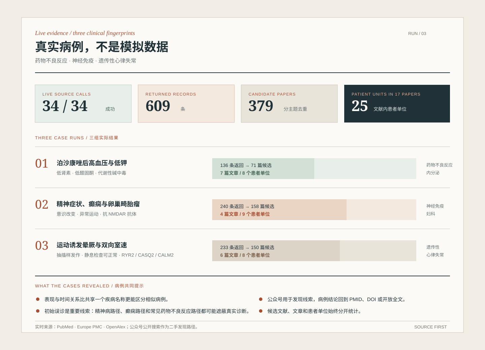
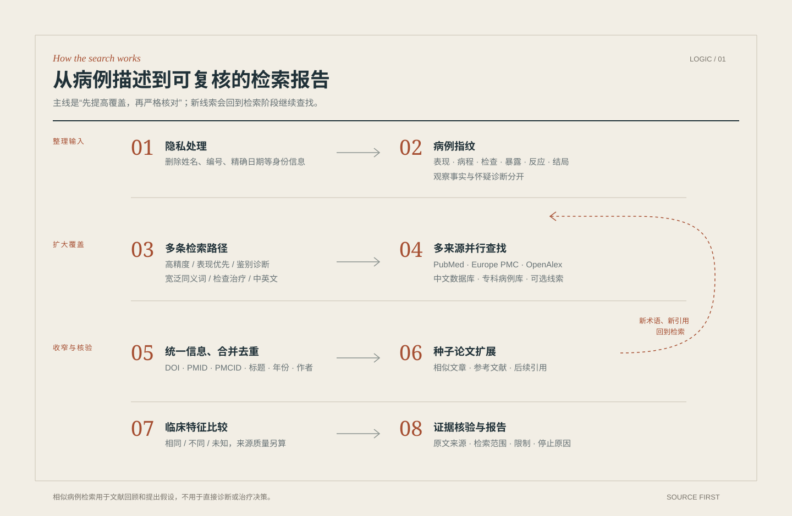
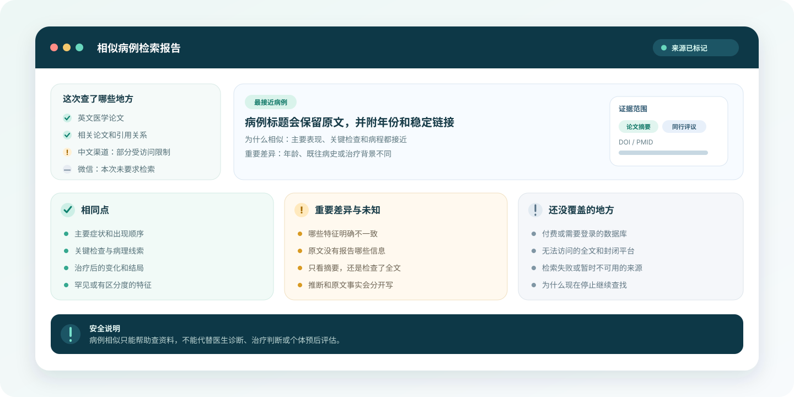

# Find Similar Medical Cases

[中文](./README.md) · [Real case details](./examples/)

A bilingual similar-medical-case retrieval Skill for medical researchers and clinicians. It starts from a de-identified clinical presentation, searches real literature and case leads, and records similarities, differences, evidence scope, and source limitations.

The project does not use simulated cases in its showcased results and does not present database hits as patient counts. Material clinical claims are traced to a PMID, DOI, accessible full text, or another verifiable original source whenever possible.

## How to use it

After installing the Skill in Codex, describe an already de-identified case in ordinary language. Age band, symptom sequence, key tests, medication or exposure, and treatment response are more useful than a complete chart.

Do not provide names, contact details, identity documents, medical-record numbers, exact addresses, or clinical documents containing identifying information.

## Live case demonstrations

Three different clinical fingerprints were searched live on 23 August 2026 through PubMed, Europe PMC, and OpenAlex. Public WeChat search was used only to discover Chinese case leads; clinical conclusions were traced back to original papers.

| Complex presentation | Live result | Source-grounded conclusion | Details |
|---|---|---|---|
| Hypertension, hypokalemia, low renin, and low aldosterone after posaconazole | 10/10 source calls succeeded; 136 returned records; 71 deduplicated candidates; 7 papers explicitly described 8 patient units | Multiple reports reproduce an apparent-mineralocorticoid-excess phenotype, while responses to withdrawal, dose reduction, switching therapy, or receptor blockade vary | [Cases and identifiers](./examples/posaconazole-real-cases.md) |
| Acute psychiatric symptoms, seizures, abnormal movements, and ovarian teratoma in a young woman | 12/12 source calls succeeded; 240 returned records; 158 deduplicated candidates; 4 close papers explicitly described 9 patient units | Initial presentation can resemble primary psychiatric disease; close reports commonly combine CSF anti-NMDAR antibodies with ovarian teratoma, but recovery trajectories differ | [Cases, source coverage, and WeChat leads](./examples/anti-nmdar-real-cases.md) |
| Exercise- or emotion-triggered syncope, seizure-like activity, and bidirectional ventricular tachycardia | 12/12 source calls succeeded; 233 returned records; 150 deduplicated candidates; 6 close papers explicitly described 8 patient units | Resting tests can be normal while exercise testing exposes bidirectional or polymorphic ventricular tachycardia; reported genetic backgrounds include RYR2, CASQ2, and CALM2 | [Cases, source coverage, and WeChat leads](./examples/cpvt-real-cases.md) |

“Patient units” means the number of patients explicitly described within the selected publications. It is not an epidemiological count after definitive cross-publication patient deduplication.

## What the demonstrations show

- Presentation-first retrieval preserves important differential diagnoses across specialties.
- Timing and objective evidence are more discriminating than a shared disease label alone.
- Diagnostic detours are useful search signals: anti-NMDAR encephalitis may first enter psychiatric care, while convulsive CPVT syncope may be mistaken for epilepsy.
- WeChat and other social sources are useful for discovery, but do not independently establish clinical claims.
- Publication candidates, patient cases, and duplicate reports require separate accounting.

## What it does

- Builds a de-identified case fingerprint and keeps observed facts separate from suspected diagnoses.
- Searches through high-precision, presentation-first, differential, and broad-synonym routes.
- Uses PubMed and Europe PMC as evidence backbones, with OpenAlex and relevant Chinese routes for broader discovery.
- Follows similar papers, references, and later citations from close seed articles.
- Deduplicates publications using stable identifiers and bibliographic metadata.
- Records matched, mismatched, and unknown facts with title, abstract, full-text, or secondary-source scope.
- Reports searched, failed, restricted, and unsearched routes explicitly.

## Search logic

In one sentence: **increase coverage from several directions, then verify and compare every plausible result.**

Similarity is used to order review, not as a diagnostic probability. Clinical similarity, source quality, and retrieval confidence remain separate judgments.

## Output

Each search produces an overall report, a reproducible retrieval ledger, and candidate-publication dossiers. Selected cases retain original titles, stable identifiers, direct source links, evidence scope, similarities, important differences, unknown facts, and exclusion reasons.

## Sources and limits

English medical literature is centered on PubMed and Europe PMC, with OpenAlex used for broader discovery and citation relationships. Chinese routes can include the China Clinical Case Repository, SinoMed, CNKI, Wanfang, VIP, the Chinese Medical Journal Network, and professional WeChat leads.

Login, subscription, CAPTCHA, and paid-service restrictions are reported as access limits. They are never rewritten as zero results or bypassed.

This project supports case review, discussion preparation, research exploration, and evidence synthesis. Similar cases can generate hypotheses but cannot establish an individual diagnosis, causality, treatment suitability, or prognosis, and do not replace a formal systematic review.

## Resources

- [中文首页](./README.md)
- [Real case details](./examples/)
- [Complete Skill documentation](./SKILL.md)
- [Sources and boundaries](./references/sources.md)
- [Retrieval workflow](./references/retrieval-workflow.md)

[MIT License](./LICENSE)
