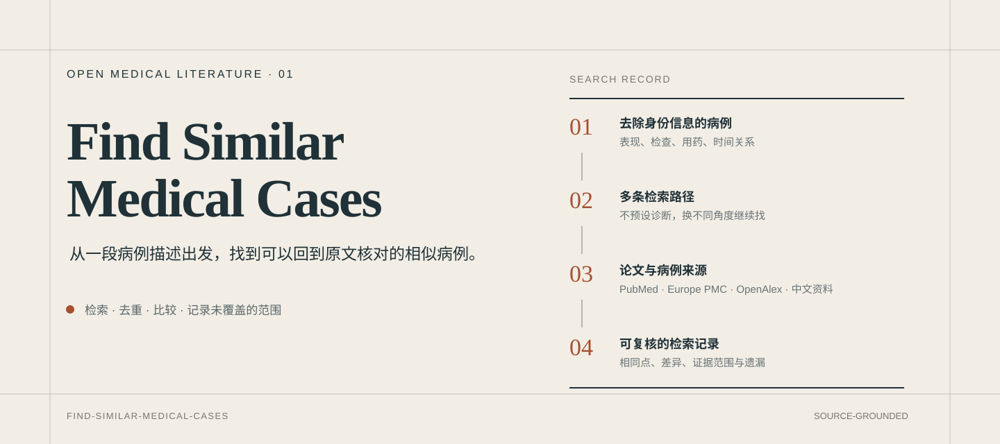

# Find Similar Medical Cases

一个面向医学研究人员和临床工作者的中英文相似病例检索 Skill。输入去标识化的复杂病例后，它会寻找可核验的真实病例，并逐例比较临床表现、关键检查、治疗和结局。

## 安装

把下面这句话直接发给支持 Agent Skill 的 AI 助手：

> 帮我安装这个病例检索 Skill：https://github.com/JuneYaooo/find-similar-medical-cases

助手会下载仓库并安装到对应的 Skill 目录。安装完成后重启 Codex、Claude Code 或其他对应 Agent，让 Skill 重新加载。

## 使用

安装后直接把已经去除身份信息的病例发给助手即可，无需指定比较维度、评分方法或输出格式。病例中建议保留年龄段、症状发生顺序、关键阳性与阴性检查、用药或暴露、治疗反应和随访结局。

> 帮我找找与下面病例相似的真实病例：
>
> （在这里粘贴病例）

Skill 会先确认主要病种、核心综合征或关键机制，再自动选择比较维度；只有通过主要病例轴核验的患者才会列为相似病例。其他仅共享症状的结果会单列为相关或鉴别病例，并给出差异、治疗、结局和原始文献。

不要输入姓名、联系方式、身份证件、病历号、精确地址、精确住院日期或带有身份信息的检查资料。

## 使用效果

本轮输入来自中国临床案例成果数据库的公开病例。收到的 3 个链接中前两条相同，因此以下按 2 个唯一病例展示，不把重复链接当成第三个病例。

### Case 1：以复杂性心悸为首发表现的多病因共存

**输入病例**

53 岁男性，反复心悸 1 个月。早期多在 11:00 和 16:00 左右发作，持续 10～15 分钟，进食后迅速缓解；后期变为持续数小时的心悸并伴胸闷。发作期血糖 2.7 mmol/L，符合 Whipple 三联征；OGTT 2 小时血糖 10.28 mmol/L、胰岛素 1 371 pmol/L，HOMA-IR 3.65。血钾 3.02 mmol/L，尿钾排泄分数大于 20%，考虑长期饮酒相关肾性失钾。冠脉 CTA 显示左前降支中段浅表型心肌桥，动态心电图未见器质性心律失常。经饮食运动、二甲双胍、补钾、美托洛尔、阿托伐他汀和戒酒治疗，6 个月后无心悸、胸闷或低血糖，糖耐量、血钾和肝功能恢复。

输入来源：[公众号原文](https://mp.weixin.qq.com/s/J4qxDi9H_YQ8G7JnOIxQKA)；正式记录 DOI：`10.3760/cma.cmcr20260426-01939`。

**TOP 3 相似病例**

| 相似病例 | 加权相似度 | 证据覆盖 | 主要相似点 | 重要差异 | 治疗 | 结局 | 来源 |
|---|---|---|---|---|---|---|---|
| 47 岁女性，胃切除术后早、晚期倾倒综合征 | **67 / 100 · 较相似** | 85% | 同为进食相关的心悸、心动过速和低血糖 | 该例在餐后发作，有明确胃切除背景，无低钾和心肌桥 | 饮食调整、阿卡波糖；早期症状加用奥曲肽 | 晚期低血糖症状改善；奥曲肽控制心悸和心动过速，但出现餐后高血糖 | [PMID 23708181](https://pubmed.ncbi.nlm.nih.gov/23708181/) |
| 男性，胰岛素瘤一度被解释为房颤 | **64 / 100 · 较相似** | 85% | 同有反复低血糖、心悸、进食后缓解和诊断绕路 | 该例为胰头肿瘤导致内源性高胰岛素血症 | 开放手术切除胰头肿瘤 | 术后情况稳定，2 天后出院；原文未报告长期随访 | [PMID 37026903](https://pubmed.ncbi.nlm.nih.gov/37026903/) |
| 27 岁男性，Graves 病伴低钾及甲巯咪唑诱导的胰岛素自身免疫综合征 | **61 / 100 · 较相似** | 100% | 同时出现心悸、低血糖和低钾 | 该例病因为甲亢、低钾性周期性麻痹及药物诱导自身免疫 | 补钾、停用甲巯咪唑、调整饮食，之后以碘-131 治疗 Graves 病 | 停药后未再发生低血糖；2 个多月后胰岛素明显下降 | [PMID 32973942](https://pubmed.ncbi.nlm.nih.gov/32973942/) |

这组检索能较好找出“低血糖引起心悸”和“低血糖、低钾共同出现”的真实病例，但没有找到同时具备反应性低血糖、心肌桥和肾性失钾的独立病例，因此没有标为“高度相似”的结果。

[查看 5 个已核验病例及逐维度比较](./examples/cmcr-complex-palpitations.md)

### Case 2：感染性结肠炎继发 BADAS，并有区域异质性皮损

**输入病例**

62 岁女性，发热 10 天、四肢疼痛性皮疹 1 周。发病前有不洁饮食和急性肠道症状，热退后出现皮损及多关节痛。上肢为红斑、丘疹和脓疱，下肢为对称暗红斑片及皮下结节，均有明显压痛。艰难梭菌谷氨酸脱氢酶抗原和毒素 A/B 阳性，肠镜显示结直肠重度活动性炎症伴糜烂；上肢皮损病理为白细胞碎裂性血管炎，下肢为间隔性脂膜炎。诊断为产毒性艰难梭菌感染性结直肠炎继发肠相关性皮肤病关节炎综合征。经糖皮质激素、沙利度胺、非甾体抗炎药及肠道黏膜修复、菌群调节治疗，皮损和关节症状完全消退，随访 2 个月无复发。

输入来源：[公众号原文](https://mp.weixin.qq.com/s/FYbbwpfW6y1XCoKRggDW8Q)；[中国临床案例成果数据库正式记录](https://rs.yiigle.com/cmaid/1685373)。

**TOP 3 相似病例**

| 相似病例 | 加权相似度 | 证据覆盖 | 主要相似点 | 重要差异 | 治疗 | 结局 | 来源 |
|---|---|---|---|---|---|---|---|
| 50 岁患者，阑尾炎相关 BADAS | **83 / 100 · 高度相似** | 90% | 急性肠道炎症前后出现四肢脓疱出血性血管炎及多关节受累 | 不是艰难梭菌感染，未报告脂膜炎或上下肢不同病理 | 系统性抗生素和糖皮质激素 | 皮肤及关节症状消失；原文摘要未报告长期随访 | [PMID 17660731](https://pubmed.ncbi.nlm.nih.gov/17660731/) |
| 29 岁男性，小肠细菌过度生长相关 BADAS | **73 / 100 · 较相似** | 100% | 同样无肠道手术和既往 IBD，由肠道细菌因素伴随皮疹、发热、关节痛和腹泻 | 病程约 1 年，病原与皮损病理不同 | 多西环素 0.2 g/d、甲泼尼龙 40 mg/d 治疗 1 周后逐渐停激素 | 症状显著改善，随访 12 个月无复发 | [PMID 27652124](https://pubmed.ncbi.nlm.nih.gov/27652124/) |
| 31 岁女性，溃疡性结肠炎相关 BADAS | **63 / 100 · 较相似** | 100% | 发热、多关节痛、对称紫红色丘疹脓疱及白细胞碎裂与输入高度接近 | 基础病为溃疡性结肠炎，无艰难梭菌和脂膜炎 | 头孢曲松、糖皮质激素和美沙拉嗪 | 2 周明显改善，3 个月皮损完全消退，胃肠道症状改善 | [PMID 39525209](https://pubmed.ncbi.nlm.nih.gov/39525209/) |

这组检索对 BADAS 的“肠道触发、疼痛性皮损、关节症状”主轴识别较好，也能找到感染或细菌相关的近邻病例；但未找到另一例同时报告艰难梭菌感染和上下肢两种不同组织病理。

[查看 5 个已核验病例及逐维度比较](./examples/cmcr-badas.md)

### 详细过程

[查看病例指纹、检索阶段、相似维度、分级依据和结果索引](./examples/search-details.md)。

## 社区

感谢 [LINUX DO — 中文开发者社区](https://linux.do/) 对开源技术交流和知识共创氛围的长期推动。欢迎通过 GitHub Issue 或社区讨论反馈真实病例检索、维度评分和证据展示中的问题。

## 免责声明

本项目只用于病例回顾、病例讨论准备、医学文献检索和研究探索，不提供医疗诊断或治疗建议。

- 相似病例不能确定当前患者的诊断、因果关系、治疗适用性或预后。
- 加权相似度是基于已公开信息的病例维度比较，不是经过临床验证的诊断概率；证据覆盖率也不代表来源质量。
- 原始论文未报告的治疗、结局或检查不会根据常识补全。
- 公众号内容只作为病例输入或发现线索；相似病例的临床事实应回到原始论文、正式病例库或医疗机构发布内容核对。
- 紧急或个体化医疗问题应由具备资质的临床专业人员处理。
